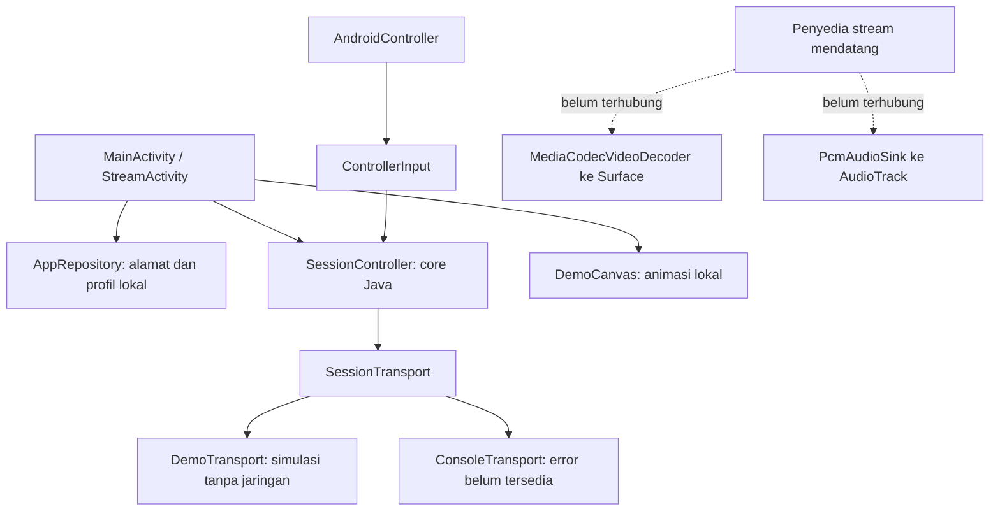

# Arsitektur original

## Batas modul dan data

`Device` adalah entri buku alamat, bukan konsol terdaftar. Host menerima IPv4, IPv6 hex tanpa zone/bracket/IPv4 suffix, atau hostname ASCII tanpa port/URL. Pemeriksaan tidak melakukan DNS. Profile memuat resolusi/FPS/bitrate/audio/dead zone; hanya dead zone yang dipakai demo. Dua preset selalu tersedia. Profil custom dapat dihapus; preset dapat diubah tanpa menghilangkan default fallback.

Penyimpanan JSON versi pertama memakai SharedPreferences privat; file korup/record tidak valid dilewati dengan event log aman. Tidak menyimpan rahasia. `apply()` memperbarui memori langsung dan menulis disk asinkron; belum ada pelaporan disk-full/durability untuk kebutuhan produksi. Backup/transfer ditolak melalui manifest dan aturan ekstraksi.

## State sesi

`IDLE → CONNECTING → DEMO_ACTIVE / STREAMING / ERROR`. `close()` menaikkan generation dan menghasilkan `STOPPED`; sesi dapat dibuka kembali. Callback dari generation lama tidak boleh menghidupkan sesi yang telah dihentikan. Kegagalan transport atau input menutup transport dan menghasilkan pesan aman.

Semua pemanggilan SessionController/SessionTransport dan callback harus dijalankan di satu owner thread (main thread dalam app). Penyedia jaringan mendatang harus melakukan I/O di worker dan memarshal hasil ke owner. Transport juga harus mengatur cancellation, timeout dan cleanup; generation guard mencegah callback basi mengubah UI, tetapi tidak menggantikan pembatalan I/O.

DemoTransport hanya memanggil readiness lokal dan menerima snapshot input. ConsoleTransport selalu mengembalikan pesan belum tersedia. State `STREAMING` disediakan untuk transport nyata mendatang dan dipakai fake transport pada unit test saja; UI saat ini tidak pernah melaporkan streaming konsol.

StreamActivity menutup demo dan listener controller pada pause, mematikan animasi/keep-screen-on dan membuka kembali pada resume. Kehilangan focus dan controller menyebabkan reset input. Kebijakan ini konservatif untuk demo; PiP, multi-window aktif dan sesi background belum didukung. Belum ada Service, Worker, retry jaringan atau koneksi persisten.

## Input

AndroidController memfilter sumber gamepad/joystick, memetakan A/B/X/Y, shoulder/trigger digital, select/start, stick click, D-pad dan axis X/Y/Z/RZ. Trigger analog memakai LTRIGGER/RTRIGGER atau BRAKE/GAS. D-pad HAT dan key digabungkan. Dead zone adalah maksimum preferensi profil dan `MotionRange.flat`, dengan rescaling kontinu ke [-1,1]. Perangkat aktif berganti dengan reset input; ini bukan multi-controller terpisah.

Bit buttons 0..15 berturut-turut: A, B, X, Y, L1, R1, L2, R2, SELECT, START, THUMBL, THUMBR, UP, DOWN, LEFT, RIGHT. Mapping ini internal, bukan format paket konsol. Belum ada remapping pengguna, adaptive trigger, rumble, HID/USB khusus atau kontrol sentuh virtual.

## Video dan audio

VideoDecoder adalah kontrak worker thread, terpisah dari transport dan UI. MediaCodecVideoDecoder memilih decoder yang mendukung seluruh MediaFormat, menerima Surface valid serta complete compressed access unit dengan timestamp mikrodetik dan flag MediaCodec. Caller menyediakan codec-specific data (misalnya AVC SPS/PPS), framing dan format yang benar. ByteBuffer input caller tidak dimutasi. Bila input codec belum tersedia `submit()` mengembalikan false, caller harus retry/menjalankan drop policy. `drain()` harus dipanggil berkala meski tidak ada input baru sampai EOS selesai; adapter saat ini tidak mengekspos event EOS/format/output-frame ke caller dan belum cocok untuk pipeline produksi.

KEY_LOW_LATENCY hanya dipakai pada API 30+ bila capability mendukung. Pada API 29+ akselerasi bisa dibaca dari codec; pada API 26–28 belum diketahui. Pemilihan decoder tidak memaksa hardware. `close()` harus dipanggil sebelum Surface dihancurkan dan setelah worker berhenti; caller bertanggung jawab terhadap ownership Surface.

PcmAudioSink menerima PCM16 44,1/48 kHz mono/stereo, nonblocking write dan mengembalikan jumlah sample terpakai. Caller menjaga sisa buffer, ordering, batas antrean dan error. Caller juga harus memiliki audio focus dan menghentikan output saat focus hilang. Belum ada decoder audio terkompresi, audio focus coordinator, resampler, clock sync atau pengukuran latensi. Adapter belum dihubungkan ke UI demo.

## Logging dan ekstensi

AppLog hanya dipanggil dengan event yang dikendalikan source, seperti state sesi dan record penyimpanan yang tidak valid. Tidak log host, nama, PIN/token, raw exception atau payload. Error pengguna tidak mengekspos internal transport.

Sebelum provider konsol nyata ditambahkan, perlu kontrak konfigurasi media/packet sink antara transport dan decoder, negotiated format/CSD, timestamp dan ownership buffer, worker/cancellation coordinator, audio focus serta Surface lifecycle. Interface saat ini adalah fondasi, bukan implementasi protokol. Riset publik tidak menyediakan kode/protokol konsol lengkap; tidak ada asumsi implementasi APK referensi yang digunakan.
