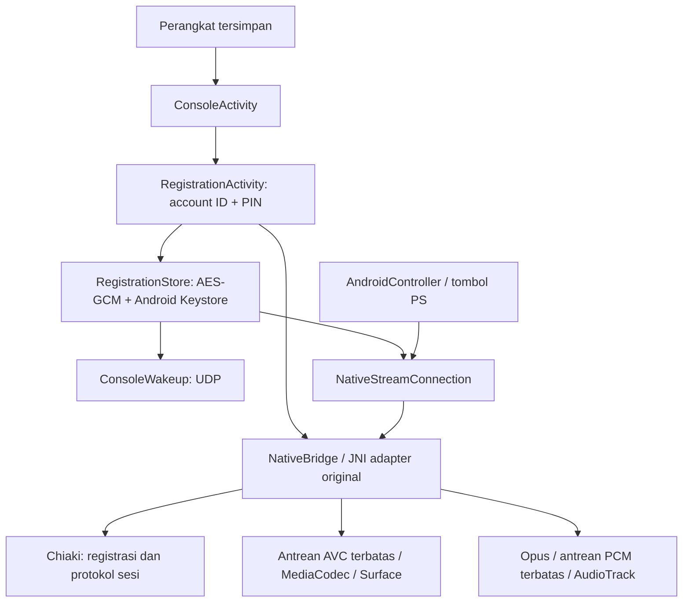

# Registrasi, wake-up dan streaming LAN

Implementasi lanjutan, 16 Oktober 2026 (Asia/Jakarta). Mesin protokol dibangun dari **Chiaki-ng 1.6.5**, commit `ca5379f4504af6e63cf5d32b5626de2425b2382e`. Ini integrasi independen, bukan klaim bahwa PXPlay memakai Chiaki. Tidak ada source, aset atau library dari APK PXPlay yang dibundel.

## Menggunakan aplikasi

1. Cari konsol di LAN atau tambah alamat manual, lalu simpan perangkat.
2. Pilih **Registrasi / wake-up / streaming → Registrasikan konsol**.
3. Pilih PS5 atau PS4. Aktifkan Remote Play dan tampilkan PIN tautkan perangkat di konsol. Masukkan PIN **8 digit** dan account ID PSN milik akun pada konsol. Account ID dapat berupa angka desimal unsigned 64-bit atau Base64 dari delapan byte little-endian; nama pengguna/email tidak dapat menggantikannya.
4. Registrasi memakai jaringan lokal dan PIN yang belum kedaluwarsa. Setelah hasil diterima, data pairing disimpan terenkripsi. PIN tidak disimpan. Login PSN otomatis dan pengambilan account ID dari layanan PSN belum disediakan.
5. **Bangunkan konsol** mengirim tiga datagram wake-up. Pesan berhasil berarti paket dikirim, bukan bukti konsol sudah bangun. Konsol perlu mengizinkan Remote Play/wake-up melalui jaringan saat mode istirahat. Gunakan pencarian ulang untuk memeriksa status.
6. **Mulai streaming konsol** memakai profil resolusi, FPS, bitrate dan audio yang dipilih. Video AVC/H.264 diarahkan ke Surface Android; audio Opus didekode menjadi PCM. Gamepad Android mengirim input. Tombol PS, Options dan klik touchpad tersedia di layar; gerakan/swipe touchpad dan gamepad sentuh lengkap belum tersedia. PIN login pengguna konsol **4 digit**, jika diminta, berbeda dari PIN registrasi.

Meninggalkan layar, kehilangan Surface atau audio focus menghentikan sesi. Registrasi ulang mengganti kredensial lokal setelah berhasil; kegagalan tidak menghapus kredensial lama. Menghapus pairing dari aplikasi hanya menghapus data lokal. Aplikasi belum menyediakan koneksi PSN/internet, NAT traversal, PiP, HDR, HEVC, mikrofon, haptic atau resume sesi di background. Interoperabilitas firmware dan konsol fisik harus diuji terpisah.

## Bukti dari APK referensi

Target yang diperiksa adalah `psplay.grill.com` 6.6.0 (88), SHA-256 `1b0e15f90e7e40eca07ed9239f9179eb0eaef0730c0e0da8f62c5a75bfb6434a`. Observasi di bawah merupakan analisis statis REA/JADX, tidak membuktikan pelaksanaan atau keaslian publisher.

| Jalur APK | Bukti statis |
|---|---|
| `RegisterActivity.l2(String,long,int)` meneruskan host, tipe konsol, firmware dan parameter registrasi ke service | `ev_1229f92dcfee5db21594a2df7613379519ece33827dcb28f57167b972c482cf6` |
| `registration.l.B(...)` mengubah account ID menjadi 8 byte little-endian/Base64 untuk versi modern; menyiapkan request terenkripsi dengan PIN, mengirim HTTP ke port 9295, lalu membaca MAC, nickname, registration key dan RP key dari respons | `ev_2e50f4e06a143a22a4dd2ee63751a0cf1108f7424d7610443b946571ee9bb501` |
| `registration.l.t(...)` memilih versi protokol berdasarkan firmware | `ev_44d053cb204841a42b25786d7b476910fb12ca17d37687341407045649102ab9` |
| `T0.v.H(...)` menyiapkan UDP WAKEUP dengan credential numerik turunan registration key; mengirim sepuluh paket dengan interval 500 ms dan kemudian menunggu menurut tipe konsol | `ev_d5c7b31db3718ad18467e69181af3a23d979111a5078295ead1eea2ab8205b7b` |

[Ledger privat](../.analysis-private/CONNECTION_EVIDENCE.md), [bundle awal](../.analysis-private/connection-evidence.json), [bundle protokol](../.analysis-private/connection-protocol-evidence.json). Observasi baru memakai REA CLI/provider yang sama ketika namespace MCP tidak tersedia pada worker investigasi. File-file ini diabaikan Git. Factory URI `r.p` dan keseluruhan mesin streaming APK tidak ditelusuri; konstanta kriptografi APK tidak dipakai. Discovery mempunyai laporan terpisah di [DISCOVERY.md](DISCOVERY.md).

## Implementasi project



`NativeBridge` mengelola handle registry dengan ownership yang jelas. JNI menyalin payload callback sebelum memori provider dilepas, melekatkan/melepaskan thread JVM hanya jika diperlukan, dan menghentikan/join worker sebelum melepaskan callback global. Native logging dimatikan agar data pairing tidak masuk log. Nickname UTF-8 dikonversi melalui decoder Java, bukan diasumsikan sebagai modified UTF-8 JNI.

`RegistrationClient` menjalankan operasi native, penyimpanan dan cleanup di executor; callback UI memakai generation guard. `RegistrationStore` memakai AES-256-GCM dengan nonce acak dari provider dan device ID sebagai authenticated associated data. Kunci AES berada di Android Keystore, sementara ciphertext berada di SharedPreferences privat yang dikecualikan dari backup. Tidak ada PIN, kata sandi PSN atau kredensial pada Intent/log. Pemindahan ciphertext ke ID perangkat lain ditolak. ID buku alamat tetap dipertahankan ketika discovery menghubungkannya dengan identitas konsol, sehingga pairing tidak terputus setelah pencarian atau perubahan IP.

`NativeStreamConnection` memakai antrean video empat unit dan audio dua belas frame, worker media terpisah, retry/backpressure terbatas dan cleanup asinkron. Native handle/input dilindungi lock; callback dari koneksi yang sudah dihentikan tidak mengubah UI. Controller buttons diterjemahkan dari layout internal ke layout Chiaki; trigger analog/digital digabung. Statistik video menghitung unit yang diterima codec, bukan pengukuran FPS layar, latensi atau kualitas jaringan. Belum ada AV-sync/jitter-buffer produksi atau pengukuran performa konsol.

## Build dan source provider

Sediakan JDK 21, Android SDK Platform 36 / Build Tools 35.0.0, **NDK 28.2.13676358**, **CMake 3.22.1** dan Windows PowerShell. Build pertama mengunduh source archives ke direktori build yang diabaikan Git. URL dan SHA-256 dipin di `app/src/main/cpp/dependencies.json`; `scripts/bootstrap-native.ps1` memverifikasi archive sebelum memakai cache. CMake membangun arm64-v8a dan x86_64, memakai optimisasi media serta ELF page alignment 16 KiB. UI default berbahasa Inggris; nama tombol pada petunjuk Indonesia di atas merupakan padanannya.

Port Android menyertakan dua perubahan sumber kecil yang eksplisit pada bootstrap: assignment pthread handle memakai integer 0, dan entry `pthread_clockjoin_np` khusus glibc yang tidak dipakai jalur sesi/registrasi dikecualikan pada Android. Header `strings.h` disertakan untuk dua dependensi FEC yang memanggil `bzero`. Tidak ada compiler diagnostic yang disembunyikan untuk menutupi ketidakcocokan tersebut.

`generated/takion.pb.c/.h` sudah disertakan, sehingga build APK tidak membutuhkan Python/protoc. File tersebut dihasilkan dari schema pinned Chiaki dengan Nanopb 0.4.6. Full license texts, notice source dan pin dependensi tersedia dari tombol **Lisensi dan source mesin koneksi**. Detail komponen ada di [THIRD_PARTY_NOTICES.md](../THIRD_PARTY_NOTICES.md).

```powershell
.\gradlew.bat :app:assembleDebug :app:assembleDebugAndroidTest :app:lintDebug
.\gradlew.bat :core:test
```

Hasil build, tes loopback, Android Keystore dan batas pengujian aktual dicatat di [VALIDATION.md](VALIDATION.md). Tidak ada konsol fisik atau kredensial pengguna yang dipakai untuk pengujian otomatis.
