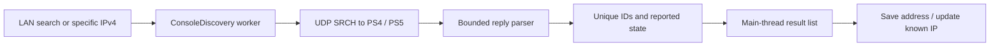

# Console search: evidence and implementation

Investigated 16 October 2026 (Asia/Jakarta). Scope: local PS4/PS5 discovery, including a known-IP probe. Internet/PSN search, registration, wake-up and streaming are outside this implementation.

This report records the discovery investigation. The later registration, wake-up and native streaming integration is documented separately in [CONNECTION.md](CONNECTION.md).

## Observed in the supplied APK

Target: `PXPlay-v6.6.0-full-apkvision.apk`, package `psplay.grill.com`, version 6.6.0 (88), SHA-256 `1b0e15f90e7e40eca07ed9239f9179eb0eaef0730c0e0da8f62c5a75bfb6434a`. REA MCP 6.5.0 / JADX headless MCP 0.7.1 inspected it. The APK was neither installed nor executed; signature authenticity is unverified. Decompiled aliases are not original names. These are static observations, not proof of a successful search.

| Observed code path | REA evidence |
|---|---|
| `HomeActivity.T2()` calls `T0.b.c()` for LAN discovery; `S2(String)` calls `T0.b.d(String)` for IP discovery. Both incoming interface invokes are at DEX code-unit offset 8. | `ev_b2fa3eea270979dcb1e277789e967d4cd31f316f151d0d7fdc38cb22c9e8210f`, `ev_2a35a287ab67120c6bf750ff3b497773845b98a068e177dea52acdf42aca2728`; reference evidence `ev_df3cfd77662cf95e931512d7a597b3349a04303c484691b8ce8025f9c1da06c6`, `ev_c9c35c6e3ca3fce02526b1d3000d52aff15e963fdc8f8622bb427fe6ddb44010` |
| `T0.v.D()` sends request pairs to `255.255.255.255`, UDP **987 / 9302**, 20 times with 250 ms sleeps, then five pairs per interface broadcast, dividing the remaining nominal 15 seconds between them. | `ev_8d1beb5f8df875ed8a2a9e5566abe976025de2d60759893dd2b1f7aca3b351b3` |
| `T0.v.B(String)` probes the supplied address on both ports, at most ten pairs, sleeping 50, 100, …, 500 ms after sends. Senders run on background threads. | `ev_c45b7062095e7bba39914d11f2a65c2c86ed28302e4d03bf4247f532da39ba44`, `ev_be37b1e25228e8f67109cc1986dfc33a5474fa4a561811c0ce6234b8b9e1660a` |
| `T0.v.S(String)` parses HTTP-like status and colon-separated headers. `P(DatagramSocket,Thread)` uses the packet sender IP, `host-type`, `host-id`, `host-name` and status to build `T0.d` records. | `ev_31c4108f0855dbc4ca5ff0478c9decf9d33863d47bd8a7d985ad80a5a6d47afe`, `ev_48834010e84c37bbaf659ab823bae34dd3a1f84250bce9c218ddbf40200a759f` |
| `T0.v.z(String,List)` suppresses duplicate host IDs. Receiver `P` starts with a 15,000 ms receive timeout, switches to 3,000 ms, and finishes relative to the last new console. This is not a strict 15-second wall-clock bound under arbitrary traffic. | `ev_2e8ba8e1fe907b274398ab3ecb3635584b46e5ac5ed43c3671d570bb7f4f97ca`, receiver evidence above |
| `T0.v.R(...)` posts listeners to the main looper. `HomeActivity.p(List)` handles zero/one/multiple results; `Y2(List)` prefers IDs matching saved registration MACs if any match, otherwise retains all. `B4(List)` presents a selector. `d3(T0.d)` branches on status 620 before registered-console handling. | `ev_f0721776639e2954e3d0f647140147492feb2afdd9a21f0645d502b123e52fce`, `ev_ef55b7dda0a0b50fbb268b5a19d73cd02720b37211b245d168c9b57e266a24d2`, `ev_7009e342ecde67c2a7018648f768e543e0db202263a0ce2f60fb34039998f9ee`, `ev_8507e236a28f9a99411606206f117d040676425cc66fc74b5f2abae518a14c68`, `ev_d4f7d97e04178a7c514ddb69eaa5bcce17792d9c94b11fa5a65ba8c19f71eb10` |

### Request anomaly

`T0.v.<init>()` contains header `device - discovery - protocol - version` with spaces, and PS4 version `0020020` (seven digits). Evidence: `ev_b51aa4c0ebcab67b47001950bcec003e546da7cfc638bca196d2395de3fcc36a`.

Separate ordinary-shell byte inspection corroborated these strings in `classes.dex` at byte offsets **1821466** (PS4) and **1821414** (PS5). These are string locations, not instruction offsets. The cause of the anomaly and any working runtime fallback are unknown. Filename/package metadata do not establish publisher authenticity.

The new implementation uses canonical header `device-discovery-protocol-version`, PS4 version `00020020` and PS5 version `00030010`, corroborated by the [Chiaki discovery header](https://raw.githubusercontent.com/streetpea/chiaki-ng/main/lib/include/chiaki/discovery.h). The [Chiaki discovery implementation](https://raw.githubusercontent.com/streetpea/chiaki-ng/main/lib/src/discovery.c) corroborates the request and status 200 (ready) / 620 (standby). Only wire-format facts were used; no APK or Chiaki source implementation was copied or added as a dependency.

### Actual evidence artifacts

- [Decompiled method excerpts with evidence IDs](../.analysis-private/PXPLAY_SEARCH_EVIDENCE.md).
- [Full REA bundle](../.analysis-private/pxplay-search-evidence.json): 39 records, including raw responses, artifact/engine identity and limitations.
- [DEX byte observations](../.analysis-private/pxplay-search-dex-strings.json), explicitly separate from REA evidence.

Private artifacts are Git-ignored; this public document publishes behavior and locators, without decompiled method bodies. Recovered static references do not establish every reflective/dynamic call. PSN search and the downstream pairing/streaming paths were not traced in this investigation.

## Independent feature in this project

`DiscoveryProtocol` builds ASCII requests with CRLF and an empty terminating line. Its original parser respects the datagram offset/length, validates UTF-8 and syntax, splits at the first colon, permits LF/CRLF and one trailing NUL, and rejects malformed/oversized/conflicting records. An advertisement needs a bounded ID and PS4/PS5 type; display names fit the existing 60-character address-book limit. The actual sender's IPv4 address supplies the host field. Names, IDs and power states are unauthenticated advertisements, not proof of identity.

`ConsoleDiscovery` sends every 250 ms to global and active-interface IPv4 broadcasts, or explicit targets. It uses one worker/socket per run, deduplicates normalized host IDs, emits changed advertisements, caps results at 128, and enforces a monotonic **15-second scan deadline** even under duplicate/malformed traffic. Close unblocks receive, and replacing a run invalidates callbacks. These are independent design choices; the timing and parser deliberately differ from the APK.

`MainActivity` marshals callbacks to its Handler with a generation guard, stops search on pause, and presents progress/cancel/empty/error/results. Multiple consoles have individual save actions. Saving is explicit. `AppRepository` preserves existing device IDs and custom names while associating a discovered host-id; this preserves separately encrypted pairing credentials across searches and IP changes. It stores no registration secrets itself. All discovered consoles remain visible rather than applying PXPlay's registered-console preference filter.

The manifest adds `INTERNET` for UDP. Scans start only on user action. IPv6 and internet/PSN search are not provided. Wake-up, pairing and streaming now use separate flows described in CONNECTION.md; discovery alone does not invoke them. Guest-network isolation, broadcast filtering, VPN routing and console settings can prevent results. No physical-console interoperability is claimed.

## Verification

Run `:core:test :app:assembleDebug :app:assembleDebugAndroidTest :app:lintDebug`. Protocol tests use synthetic replies. Scanner tests use real loopback UDP fake consoles, including both generations, retries, duplicate/state updates, malformed traffic, finite deadline, cancellation and replacement. Android tests cover address merge/IP-change persistence and search controls; compiling instrumentation is separate from running it. Executed results are recorded in [VALIDATION.md](VALIDATION.md).
